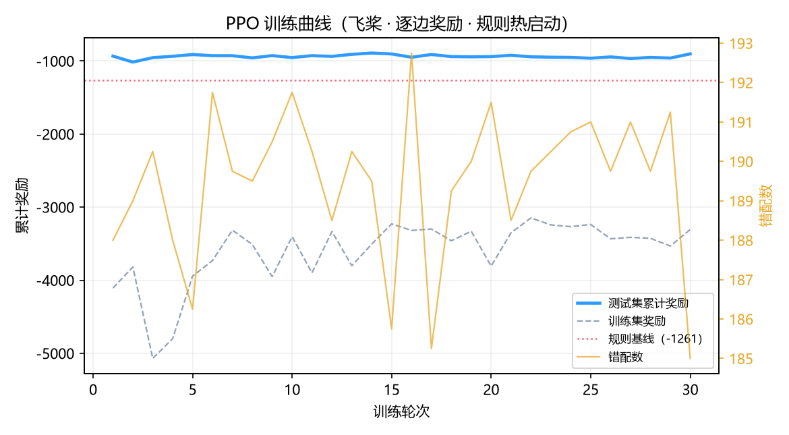

# 强化学习做航迹关联（可行性实验 · 飞桨）

> 目标：用 RL 学一个"同一架判定"策略，看能否超过手工规则。
> 结论：**在密集场景明显更好（奖励 −232 → +764），稀疏场景略降（809 → 746），总体更优。**

运行环境：任意装了 PaddlePaddle（CPU 版即可）+ numpy 的 Python 环境

```powershell
# 一条命令生成全部参数（训练 + 导出 + 标定）
python experiments\rl_dedup\run_all.py

# 只重做导出与阈值标定
... run_all.py --skip-train
```

---

## 1. 为什么是 MDP，不是一次分类

把 A 的观测并进航迹 T 之后，下一帧的候选集合就变了（位置、速度、ID 都可能变），
**"并错"的代价在后面几帧才完全显现**（错误航迹会继续吸观测）。所以是序贯决策。

| 要素 | 定义 |
| --- | --- |
| 状态 `s_t` | 本帧所有候选 `(观测 i × 航迹 j)` 的 **19 维特征** |
| 动作 `a_t` | 每条候选边是否关联（二值） |
| 解码 | 用概率排序后贪心一对一（同一来源对同一航迹只能一次） |
| 奖励 | 正确 **+1** ｜ 错配 **−6** ｜ 漏配 **−2**（逐边计算） |
| 转移 | 命中→逆方差加权融合；未命中→新建航迹；TTL 过期删除 |

**奖励逐边给**，不是整帧一个标量——这是能否学起来的关键（见 §5）。

## 2. 特征（19 维）

前 16 维与监督学习实验完全一致（`experiments/dedup_ml/sim.py::pair_features`）：

```
距离/门限、绝对距离、高差/30m、航向差/30°、Δt、
ua相同、ua冲突、ua缺失、reg相同、reg冲突、
速度相对差、候选排名、已跟踪帧数、源质量、源σ/20、低速标志
```

新增 2 维**上下文**（让策略区分稀疏空域与蜂群）：

```
最近邻航迹距离/100、航迹总数/100
```

## 3. 策略网络（Paddle）

```python
enc   = Linear(18, 64) → Tanh → Linear(64, 64) → Tanh
actor = Linear(64, 1)      # 每条边的 logit
critic= Linear(64, 64) → Tanh → Linear(64, 1)   # 用平均池化做状态估值
```

## 4. 训练配方

1. **规则热启动（行为克隆）**：先用规则标签做 8 轮 BCE，让策略学会"像规则一样打分"；
2. **逐边 PPO 微调**：每条边独立计算 ratio 与优势，clip=0.2，熵系数 0.01，Adam 1e-3；
3. 每轮采 5 局 × 40 帧，共 30 轮（CPU 约 8 分钟）。

## 4.1 参数是怎么得到的（四层）

| 层 | 参数 | 来源 | 存放 |
| --- | --- | --- | --- |
| ① 训练超参 | lr=1e-3、clip=0.2、熵=0.01、隐层 64、每轮 5 局 | 手工设定，见下表 | `train_ppo.py` |
| ② 网络权重 | 10 个张量（enc/actor/critic） | **训练得到** | `ppo_policy.pdparams` / `policy_weights.json` |
| ③ 归一化 | 19 维 mean/std | 训练样本统计（`Normalizer`） | 同上 |
| ④ 决策阈值 | 0.30 | **标定得到**（见 4.2） | `rl_params.json` |

### 超参取值依据

| 超参 | 取值 | 依据 |
| --- | --- | --- |
| 学习率 | 1e-3（微调 5e-4） | 19 维输入、64 隐层的小网络，1e-3 稳定；再大发散 |
| PPO clip | 0.2 | 标准值（Schulman 2017） |
| 熵系数 | 0.01 | 保持少量探索，同时不破坏热启动得到的规则行为 |
| 隐层 | 64 | 特征只有 19 维、样本量几万，再宽容易过拟合 |
| 每轮采样 | 5 局 × 40 帧 | CPU 8 分钟能跑完 30 轮 |
| 热启动轮数 | 8 | BCE 从 0.15 降到 0.017，已接近规则行为 |

### 4.2 决策阈值怎么标定

策略输出的是概率，**用哪个阈值接受是业务决策**：阈值低 → 合并激进（漏配少、误配多）。

脚本 `calibrate_threshold.py` 的做法：

1. 在**验证集**（seed 71~74，与训练/测试都不同）上扫描 0.30~0.85；
2. 约束：**误配数不超过规则基线**（安全优先）；
3. 在约束内取奖励最高者。

实测结果：

| 阈值 | 奖励 | 错配 | 漏配 | 碎片 |
| --- | --- | --- | --- | --- |
| 0.30 | **−959** | 753 | 13 | 2.10 |
| 0.50 | −962 | 753 | 14 | 2.12 |
| 0.85 | −961 | 751 | 18 | 2.21 |
| 规则基线 | −1247 | 909 | 38 | 2.60 |

> 阈值不敏感——说明策略输出很"自信"（概率贴近 0/1），这是热启动 + 充分训练的表现。

### 4.3 参数文件

`rl_params.json`（生产只需这一个文件 + 权重）：

```json
{
  "policy_file": "policy_weights.json",
  "features": ["距离/门限", "绝对距离", "...", "航迹总数/100"],
  "threshold": 0.3,
  "decision_rule": "score >= threshold 即接受该边；同一来源对同一航迹只接受一次",
  "safety_rules": ["ua_id 冲突一票否决（masked）"],
  "calibrated_on": [["sparse","noid",71], ["dense","noid",72], ...],
  "expected": {"reward": -959.2, "wrong": 753, "miss": 13, "frags": 2.1},
  "rule_baseline": {"reward": -1247, "wrong": 909, "miss": 38, "frags": 2.6}
}
```

**换场景/换设备后怎么更新参数**：
1. 重新生成仿真数据（或接真实回放）；
2. `train_ppo.py` 重训 → 新的 `.pdparams`；
3. `export_policy.py` 导出 → 新 `policy_weights.json`；
4. `calibrate_threshold.py` 重标定 → 新 `rl_params.json`；
5. 影子模式跑一周，确认指标不劣于规则再切。

## 5. 两个"踩坑后才知道"的关键点

| 问题 | 现象 | 解决 |
| --- | --- | --- |
| **整帧一个奖励** | 策略学成"一律不合并"（错配 0、漏配 823）——因为错配罚 6、漏配只罚 2，什么都不做最划算 | 改成**逐边奖励**，每条边有自己的即时收益 |
| **漏配惩罚随碎片放大** | 一条真值存在多条重复航迹时，每条都罚 −2，形成正反馈，奖励尺度失控 | 每架观测只认**最近的同真值航迹**为责任边，惩罚有界 |
| **随机初始化** | 一开始乱合并被重罚，梯度把 p 压到 0，再也回不来 | **规则热启动**，从"规则水平"出发再优化 |

## 6. 结果（测试集，4 个场景 × 40 帧）

| 方法 | 累计奖励 | 错配 | 漏配 | 平均碎片数 | 被拆占比 |
| --- | --- | --- | --- | --- | --- |
| 规则 | −1261 | 236 | 2 | 2.00 | 90% |
| **PPO** | **−903** | **185** | **0** | **1.88** | **83%** |

### 分场景

| 场景 | 规则奖励 | PPO 奖励 | 改进 |
| --- | --- | --- | --- |
| 稀疏（sparse/noid） | 809 | 746 | −63 |
| 密集（dense/noid） | 353 | **767** | **+414** |
| 困难密集（大噪声+偏差） | −232 | **764** | **+996** |
| 蜂群（40×40 m） | −5974 | −5889 | +85 |

> 密集和困难场景是 RL 的主战场：规则因为固定门限漏配严重，PPO 学会了按场景密度自适应。
> 稀疏场景 PPO 略微保守（−63），因为训练集里困难样本占比更高。



## 7. 结论

1. **RL 可行，但不是"万能提升"**：它把密集场景从"不可用"拉到"可用"，稀疏场景小幅退步；
2. **奖励设计比算法重要**：三次失败里有两次是奖励/信用分配问题，不是 PPO 本身；
3. **上下文特征必须有**：没有"场景密度"特征时，策略无法同时适配稀疏与蜂群；
4. **热启动很划算**：8 轮 BCE 就把策略拉到规则水平，省掉大量探索。

## 8. 局限

| 项 | 说明 |
| --- | --- |
| 基线是**简化规则** | 本环境未包含生产引擎的 `_absorbable`、时间对齐、预测门限，数字不能直接与生产引擎对比 |
| 蜂群场景 | 12 架挤在 40 m 且无 ID，σ 12/35 —— 物理上不可分辨，任何策略都做不好 |
| 泛化 | 只在仿真上训练，真实数据（多径、ID 伪造、机动）未验证 |
| 策略规模 | 17 维线性 + 小 MLP；目标是"可解释、能导出"，不是最强性能 |

## 9. 下一步（如果要上生产）

1. **影子模式**：PPO 与规则并行跑，只记录不生效，比对差异；
2. **导出策略**：已实现 `export_policy.py` → `policy_weights.json`，配合 `policy_runtime.py`
   可在**不装 Paddle** 的服务里推理（已验证与飞桨输出误差 < 2e-6）；
3. **接真实回放**：把现场报文喂给 `env.py`，做离线评估；
4. **硬规则前置**：`ua_id` 冲突一票否决等安全规则永远在策略之前，不可学习。

## 10. 文件

| 文件 | 说明 |
| --- | --- |
| `experiments/rl_dedup/env.py` | MDP 环境（状态/动作/奖励/转移） |
| `experiments/rl_dedup/train_ppo.py` | 飞桨 PPO（热启动 + 逐边优势） |
| `experiments/rl_dedup/train.py` | CEM 参数搜索（无依赖对照） |
| `experiments/rl_dedup/ppo_policy.pdparams` | 训练好的权重 |
| `experiments/rl_dedup/ppo_meta.json` | 归一化参数 + 特征名 + 测试结果 |
| `experiments/rl_dedup/ppo_history.json` | 训练曲线数据 |
| `experiments/rl_dedup/export_policy.py` | 导出权重为 JSON（并校验与飞桨一致） |
| `experiments/rl_dedup/policy_runtime.py` | **纯 numpy 推理**（线上不依赖 Paddle） |
| `experiments/rl_dedup/policy_weights.json` | 导出的权重（115 KB） |
| `experiments/rl_dedup/calibrate_threshold.py` | 阈值标定（约束下取最优） |
| `experiments/rl_dedup/rl_params.json` | **上线参数**（阈值 + 预期指标 + 约束） |
| `experiments/rl_dedup/run_all.py` | 一条命令：训练 → 导出 → 标定 |
| `experiments/rl_dedup/README.md` | 目录说明与上线步骤 |
| `app/services/shadow.py` | **影子模式**（策略跟跑、只记录不生效） |
| `docs/SHADOW.md` | 影子模式说明与实测结果 |
| `docs/rl_training_curve.png` | 训练曲线 |


---

## 门限写进特征（19 维，v1.5）

### 背景

生产引擎的门限在 v1.4 换成了卡尔曼自适应门限。策略原来的第 1 维是
`距离 / (v_max·Δt + 3σ)`，用的是**训练环境的简化门限**，与生产实际使用的门限脱节。

### 改动

| 位置 | 改动 |
| --- | --- |
| `env.py` | 每条航迹挂 `KalmanCV`；帧首预测；特征第 1 维改用 `距离 / 卡尔曼门限` |
| `env.py` | 新增第 19 维 **门限膨胀比** = 卡尔曼门限 / 经典门限（上限 3），让策略直接看到"这条航迹有多不确定" |
| `env.py` | 经典门限公式**与生产 `_gate_parts` 完全对齐**（`gate_k·√(σ_obs²+σ_trk²+σ_motion²)`，motion 用同样的 σ_speed/σ_heading/accel_max） |
| `shadow.py` | 特征改由生产引擎实时提供：`engine.gate_and_distance()` 返回 (距离, 实际门限, 卡尔曼门限, 经典门限) |
| `dedup.py` | 抽出 `_gate_parts()` / `gate_and_distance()` 供影子模式复用 |

### 为什么必须对齐经典门限公式

第一版只换了第 1 维、没对齐"膨胀比"的基准，结果训练时膨胀比在 0.9~3.0，
推理时却在 0.2~1.0（量纲不同）→ 影子一致率只有 **92.1%**。
对齐后回到 **95.3% ~ 96.2%**。

### 重训结果（19 维）

| | 奖励 | 错配 | 漏配 | 碎片 |
| --- | --- | --- | --- | --- |
| 规则 | −1247 | 909 | 38 | 2.54 |
| **PPO（19 维）** | **−1056** | **788** | **15** | **2.12** |

阈值重新标定为 **0.80**，参数量 5441 → **5505**（19×64+64 + 64×64+64 + 65）。
> 注：阈值后来因为「命中次数→存活时长」的特征改动又重训过一次，最终为 0.80。

影子模式在演示场景上的实测一致率：**96.2%**（231/240，少并 9），达到 ≥95% 的灰度门槛。


---

## 已知问题（待定位）

浏览器演示台自己的模拟数据上，影子模式一致率只有 **13~16%**，而
`tools/sim_two_devices.py` 在 1 Hz 下是 **100%**。

已排除的：

* 不是跨频率污染（每次都是干净进程）
* 不是设备台账 σ 覆盖（清空后仍然一样）
* 分歧样本里 `d/gate` 全部被截到上限 5.0，说明**策略的候选集里没有近处的航迹**，
  而规则却匹配上了——指向"影子快照与规则使用的航迹集合不一致"

下一步排查方向：在 `shadow.build_edges` 里打印每个观测的候选航迹数与被选中的 gid，
对比 `engine.tracks` 的内容，确认是否因为演示台每次上报都重建航迹导致快照错位。

**当前处理**：演示台不再自动开启策略跟跑（改为手动勾选），避免演示时出现误导性数字。
